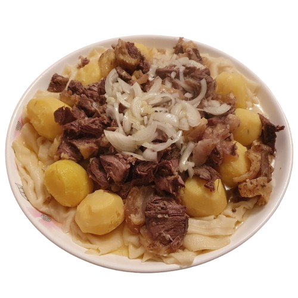

# Besh&Stuff

🇰🇿 Add a Kazakh vibe to your Minecraft!

## The mod includes:

- **Horse meat** - drops from horses, cook it in a furnace or smoker
- **Horse milking** - use an empty bucket on an adult horse
- **Baursak** - craft from 2 wheat
- **Kazy** - craft from 3 horse meats row, then cook it in a furnace or smoker for slices

## Currently on the roadmap:

- **Beshbarmak**

## License

Licensed under the [MIT License](LICENSE).
